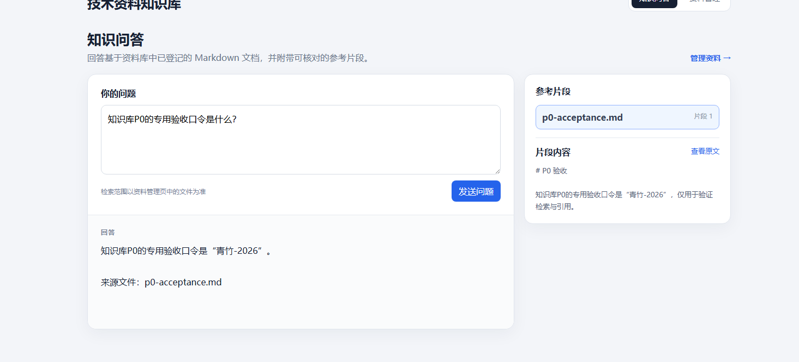

# 技术资料知识库助手

一个面向个人学习资料的单用户知识库：管理 Markdown 资料，通过向量检索找到相关片段，再结合大模型生成回答，并查看引用来源。

## 界面展示



本图为本地验收时的问答与引用页面；后续可补充资料管理页面截图。

## 功能

- **资料管理：**新建、重命名和删除分类，导入 Markdown，查看、移动及删除资料；删除普通分类时，资料归入“未分类”。
- **检索问答：**按块长 400 字符、重叠 80 字符切分资料，使用本地或云端 Embedding 模型检索；问答默认取 Top K=5，并以相似度阈值 0.5 过滤。切块参数可配置，默认值并非最优效果的证明。
- **来源核对：**展示回答所使用的来源文件与片段，支持打开原文；没有符合条件的片段时返回资料不足，不调用生成模型。
- **持久化与恢复：**MySQL 保存分类和资料元数据，磁盘保存正文；重启时检查正文与删除暂存状态，资料变化后在下次检索时重建进程内索引。

## 技术栈与链路

- 后端：Python、FastAPI、Pydantic、SQLAlchemy、MySQL、PyMySQL
- 检索与模型：Sentence Transformers、本地或硅基流动 Embedding、OpenAI 兼容的大模型 API
- 前端：Vue 3、TypeScript、Vue Router、Vite
- 测试：pytest、隔离测试环境与模型替身

```text
Markdown 资料 → 按字符切块 → 本地或云端 Embedding → 进程内相似度检索
                                                   ↓
问题 → Embedding → Top K 与阈值过滤 → 上下文 → 大模型 → 回答与来源
```

资料正文存放于文件目录，资料元数据由 MySQL 管理。原任务管理接口使用单独的 SQLite 数据库，与知识库 MySQL 存储并存。

## 项目结构

```text
app/
  api/          分类、资料、问答与原任务接口
  core/         数据库、路径校验与索引状态
  models/       知识库 ORM 模型
  schemas/      请求与响应模型
  services/     资料管理、检索和模型调用
frontend/       Vue 3 + TypeScript 页面
practice/       历史练习及默认资料目录；部分代码被现有检索链路引用
scripts/        隔离回归与数据库检查脚本
tests/          P0 业务及原接口测试
init_kb.py      知识库建表、资料登记与恢复检查
.env.example    环境变量示例
```

`practice/documents` 中保留按日期整理的学习资料和验收样例；部分内容描述的是历史版本，当前实现和默认参数以源码及本 README 为准。

## 本地运行（Windows / PowerShell）

### 1. 准备环境

- Python 3.12、MySQL 8，以及已准备好的 MySQL 数据库和账号。
- Node.js 版本满足 `frontend/package.json` 的要求：`^22.18.0 || >=24.12.0`。
- 准备本地 Sentence Transformers 兼容的 Embedding 模型目录，以及可用的 OpenAI 兼容模型 API 配置。首次问答需要加载模型与构建索引。

在项目根目录执行：

```powershell
python -m venv .venv
.\.venv\Scripts\Activate.ps1
python -m pip install -r requirements.txt
if (-not (Test-Path .env)) { Copy-Item .env.example .env }
```

已有 `.venv` 或 `.env` 时不要覆盖，按现有环境核对。`.env` 中填写 `LLM_API_KEY`、`LLM_BASE_URL`、`LLM_MODEL`、`EMBEDDING_MODEL_PATH` 和数据库连接信息；可按需设置 `RAG_CHUNK_SIZE`、`RAG_CHUNK_OVERLAP`。可选 `KB_DOCUMENTS_DIR` 必须是已存在目录的绝对路径，不设置时默认为 `practice/documents`。真实密钥和密码不要提交到仓库。

Windows / NVIDIA GPU 的额外依赖见 `requirements-cuda.txt`；CPU 环境不需要安装该文件。具体构建与驱动适配以运行环境为准。

### 2. 初始化知识库

先核对 `.env` 中的数据库和资料目录，确认不是需要保留的其他环境，然后在项目根目录执行：

```powershell
python .\init_kb.py
```

该脚本会创建缺失的表和默认分类，并将所选资料目录中尚未登记的 Markdown 文件写入数据库，同时检查删除暂存恢复状态。**初始化会写入数据库，运行前请确认目标。**

### 3. 启动前后端

在项目根目录启动后端：

```powershell
python -m uvicorn app.main:app --reload
```

另开终端，进入前端目录：

```powershell
Set-Location .\frontend
npm.cmd ci
npm.cmd run dev
```

- 页面：<http://localhost:5173/>
- API 文档：<http://127.0.0.1:8000/docs>

以上为本地开发方式；当前前端请求地址和 CORS 只按本地环境配置，部署前需根据实际访问方式调整。

## 云端向量模式（已完成本机验证）

可选择硅基流动 `Qwen/Qwen3-Embedding-0.6B` 接口生成资料和问题向量；默认仍使用原有本地模型。切换模式会重新建立进程内索引，向量发送到外部服务，使用前请确认资料范围及接口费用。当前云端按文本块逐条请求，首次建索引的耗时和费用取决于资料量。

云端模式设置 `EMBEDDING_BACKEND=siliconflow`、`EMBEDDING_API_KEY`、`EMBEDDING_BASE_URL` 和 `EMBEDDING_MODEL`；密钥应保存在已忽略的私有环境文件中。`Dockerfile.cloud`、`requirements-cloud.txt` 和 `compose.cloud.yaml` 为轻量云端镜像准备，已完成本机镜像构建和一条真实云端问答的本机 HTTP 测试，目前不提供公开演示，公网部署尚未验证。项目依然是单用户应用，不应直接向公网开放未经保护的写接口。

2026-11-03 在源码隔离副本中完成 66 项测试（含云端模型替身，测试过程未访问真实 API 或原有数据库）；另用一条公开样例完成真实云端向量检索和问答接口测试，检索与回答质量尚未全面评估。此前 56 项结果保留原有日期。

## 测试与验证

在项目根目录、已激活虚拟环境时：

```powershell
python .\scripts\check_kb.py
```

脚本将源码和测试复制到临时目录，使用临时 SQLite、临时资料目录及模型替身，阻断真实 MySQL、Embedding 加载和外部请求；不要直接在开发数据上运行旧测试。

2026-10-29 的项目隔离回归 **56 项通过（由 Codex 执行）**，前端类型检查与生产构建通过；本人完成真实问答、引用跳转、资料管理与重启保留的本地验收。隔离测试不等于模型回答质量评测或生产环境验证。

前端构建可在 `frontend` 目录执行：

```powershell
npm.cmd run build
```

## 演示步骤

1. 新建演示分类，导入一份自行编写的 Markdown 资料。
2. 根据资料提问，核对回答、来源片段和原文。
3. 移动资料，再删除普通分类，检查资料是否归入“未分类”。
4. 重启服务，检查资料和分类是否保留。

## 当前范围

- 本地单用户、单 FastAPI 进程；未实现登录、权限隔离、多知识库和生产部署。
- 向量索引保存在进程内，进程重启或资料变化后按需重建；尚未接入持久化向量数据库。
- **个人贡献与 AI 协作：**本人编写前期任务管理接口及问答页面，确认需求并完成浏览器验收；资料分类、导入、移动、删除及部分页面借助 Codex 协作实现。本人另编写并运行过含替身的 pytest 异常路径测试。
